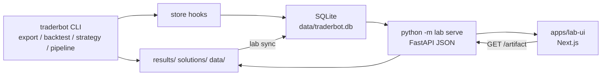

# Traderbot Lab

Lab catalogs strategy backtests in SQLite, exposes a JSON HTTP API, and ships a Next.js UI for browsing results.

## Data flow



1. CLI commands write artifacts under `results/`, `solutions/`, or `data/`.
2. On success, `lab.store` hooks upsert configuration snapshots and evaluation runs (disable with `TRADERBOT_STORE=0`).
3. `python -m lab sync --root results` backfills from existing `results.json` and `backtest_summary.json` files.
4. `python -m lab serve` reads the database and serves REST JSON plus safe file paths via `/artifact`.
5. `apps/lab-ui` calls the API from the browser (CORS enabled for `http://localhost:3000`).

Lab jobs (export, strategy compare, pipelines) run **in-process** in the API — no `cli` subprocess.

## Environment

| Variable | Purpose |
|----------|---------|
| `TRADERBOT_STORE` | Set to `0` to disable automatic recording |
| `NEXT_PUBLIC_API_BASE` | Browser API base (default `/lab-api` — proxied to FastAPI by Next.js) |
| `LAB_API_PROXY_TARGET` | Where Next rewrites `/lab-api/*` (default `http://127.0.0.1:8765`) |
| `LAB_ALLOWED_DEV_ORIGINS` | Extra hostnames for Next `allowedDevOrigins` (comma-separated). Lab UI also allowlists local interfaces plus broad `*.*…` wildcards for LAN dev. |
| `LAB_API_TOKEN` | Bearer token for protected Lab API routes (POST jobs, risk, credentials, artifact download). If unset while auth is enabled, the API generates an ephemeral token at startup and logs it once. |
| `LAB_API_DISABLE_AUTH` | Set to `1` to disable API auth (tests and trusted local dev only). |
| `LAB_API_HOST` | Bind address for `python -m lab serve` / `run-lab-api.sh` (default `127.0.0.1`). |
| `LAB_API_MAX_BODY_BYTES` | Max JSON body size for POST requests (default 2 MiB). |
| `NEXT_PUBLIC_LAB_API_TOKEN` | Optional browser token sent as `Authorization: Bearer` from the Lab UI when the API requires auth. When the API has a token but this is unset, the UI shows an amber banner on every page until you set it (see **Settings**). |
| `COINBEACON_API_KEY` | Server-side only. Primary key for `/new` discovery and `GET /api/coinbeacon/*`. |
| `COINBEACON_API_KEY_ALT` | Optional second key. Used when the primary is rate-limited (429) or daily credits fall below the job reserve. |
| `COINBEACON_API_KEYS` | Optional comma-separated extra keys (deduped with the above). Never commit real keys. |

Default database: `data/traderbot.db` (created by `python -m lab init`).

## Local development

One terminal (API + UI):

```bash
pip install -e ".[ui,dev]"
python -m lab sync --root results   # optional backfill
./run-lab.sh
```

`./run-lab.sh` starts the UI and ensures the Lab API on port 8765 is current: if something old is already listening, it is stopped and replaced (health must include `live_job_logs` and `opportunity_discovery`). Start a **new** background job after restart to see streaming logs.

Two terminals:

```bash
./run-lab-api.sh
```

```bash
./run-lab-ui.sh
```

`python -m lab serve` auto-creates the SQLite schema on startup (`data/traderbot.db`).

Dev helpers: `run-lab-ui.sh` frees `LAB_UI_PORT` (default 3000) before `next dev`. Set `LAB_KILL_UI_PORT=0` to skip. API bind address defaults to `127.0.0.1` via `run-lab-api.sh` (`LAB_API_HOST`). Set `LAB_API_HOST=0.0.0.0` only on a trusted network and always set `LAB_API_TOKEN`.

Protected routes (when auth is enabled): all `POST` endpoints, `GET /artifact`, dataset downloads, `/api/auth/*` except `/api/auth/status`, and `/api/risk/*`. Read-only catalog `GET` routes remain public. CORS is not authentication.

Open [http://localhost:3000](http://localhost:3000). API docs: [http://127.0.0.1:8765/docs](http://127.0.0.1:8765/docs).

## Layout

- `lab/store/` — schema, upserts, queries (no HTTP).
- `lab/` — FastAPI app, CORS, artifacts, allowlisted jobs.
- `cli/` — operator CLI (`python -m cli` / `traderbot`).
- `traderbot/` — strategies, pipelines, backtests, markets, live terminal.
- `apps/lab-ui/` — Next.js App Router UI only.

## UI routes

| Route | Purpose |
|-------|---------|
| `/` | Overview (research loop, stats, recent runs) |
| `/data` | Export OHLC job + download CSVs from `data/` |
| `/runs`, `/runs/[id]` | Browse runs, metrics, PNG charts, `results.json` download |
| `/configs` | Configuration snapshots |
| `/experiments` | Lab — strategy test and compare, optimizer sweeps, pipelines, compare charts. Sections: Run, Pipelines (`#pipelines`), Compare results (`#compares`), Sweeps (`#sweeps`) |
| `/actions` | Redirects to `/experiments` |
| `/new` | Start jobs — Hyperliquid opportunity discovery (catalog + universe scan), job monitor, run history |
| `/custom` | Custom end-to-end pipeline (export, multi-dataset, compare) |
| `/live` | Terminal paper/live on **Hyperliquid** (default) or Nobitex: once, poll loop, CSV replay (job log + stop) |
| `/strategies` | Hummingbot-style pair, grid, and funding **ephemeral** paper backtests (public candles; not stored in Runs) |
| `/settings` | Lab API token, **Hyperliquid** wallet/key, optional Nobitex API keys |

## API (UI-facing)

| Method | Path | Notes |
|--------|------|--------|
| GET | `/api/stats` (run counters + backtest leaderboards: strategies, markets, intervals), `/api/runs`, `/api/runs/{id}`, `/api/runs/{id}/analytics` (trade-level metrics + equity/drawdown curves from `trade_logs`), `/api/configurations`, `/api/experiments`, `/api/compare-sessions`, `/api/sweeps`, `/api/sweeps/best` (optional `horizon_label`; sweeps resolve per horizon folder, then unlabeled rows), `/api/pipelines` | Catalog |
| POST | `/api/experiments/sync` | Register `config/experiment*.json` in SQLite (no pipeline run) |
| GET | `/api/datasets` | Catalog OHLC datasets. `label` includes horizon (when the file is under `horizons/<label>/`) and the CSV start and end dates. |
| GET | `/api/datasets/{id}/download` | Download a catalog dataset file |
| GET | `/api/data/markets?scope=&q=&limit=&offset=` | Search cloned market rows in SQLite |
| POST | `/api/data/markets/sync?scope=` | Re-clone markets (`hyperliquid_all`, `nobitex_all`, or jobs file) into SQLite |
| GET | `/api/artifacts/list?out_dir=` | PNG paths under a run/solution directory |
| GET | `/artifact?path=` | Download file (`results/`, `solutions/`, `data/`) |
| GET | `/api/jobs`, `/api/jobs/{id}` | Background job status |
| POST | `/api/jobs/{id}/stop` | Stop a queued or running in-process job |
| GET | `/api/auth/status`, `/api/auth/profile`, `/api/auth/api-keys` | Auth status; `live_exchange_default` is `hyperliquid` |
| POST | `/api/auth/login`, `/api/auth/api-keys` | Optional Nobitex session login / API key (writes `.env` when requested) |
| GET | `/api/catalog/strategies`, `/api/catalog/strategy-params?strategy_id=`, `/api/catalog/optimized-strategy-params?strategy_id=&symbol=&resolution=&dataset_id=&horizon_label=` (resolves the dataset's horizon folder; `sweep_meta.sweep_horizon_label` reports the matched sweep), `/api/catalog/terminal` | Strategy and terminal catalogs |
| POST | `/api/jobs/export`, `/api/jobs/strategy-test`, `/api/jobs/strategy-compare`, `/api/jobs/strategy-sweep`, `/api/jobs/pipeline-run`, `/api/jobs/pipeline-run-config`, `/api/jobs/custom-research`, `/api/jobs/terminal-once`, `/api/jobs/terminal-replay`, `/api/jobs/terminal-live` | In-process background jobs |
| GET | `/api/strategies/exchange-catalog` | Strategy ↔ exchange matrix and default fee/slippage profiles |
| POST | `/api/strategies/pair-backtest` | Pair stat-arb (Nobitex spot or Hyperliquid perp); live `*_src` or CSV paths |
| POST | `/api/strategies/grid-backtest` | Spot grid on live candles or CSV |
| POST | `/api/strategies/funding-backtest` | Hyperliquid funding carry (public funding history) |
| GET | `/api/marketcap/global`, `/api/marketcap/coins`, `/api/marketcap/coin/{id}` | Local-first market cap rankings, global macro stats, and coin profile drawer |
| POST | `/api/marketcap/refresh` | Force sync fresh market cap data from providers into local SQLite cache |

`GET /api/pipelines` includes `full`, `steps`, and `inputs` for the Lab Pipelines tab. Full pipelines are the end-to-end jobs. The Pipelines tab keeps Active (run forms) separate from a library where you turn pipelines on or rename the label in this browser. `POST /api/jobs/pipeline-run` takes `pipeline_id` plus those inputs (`dataset_id`, `days`, `all_assets`, `horizon`, `fast`, `slow`). Saved configs use `pipeline-run-config`, which accepts the same `params` and per-step `step_params` the form shows.

`strategy-test` and `strategy-compare` take `mode`: `strategies` (rule strategies only). `strategy-test` also requires `strategy_id`. Both jobs accept optional `cash`, `fee`, `slippage` (fractions, e.g. `0.001`), `execution` (`close` or `next_open`), `vectorbt`, and strategy knobs (`fast`, `slow`, `signal`, `period`, `oversold`, `overbought`, `num_std`, `context_bars`, `price_confirm`). Returns are net of fee + slippage; `next_open` fills at the next bar open (last-bar signals expire).

`strategy-sweep` (optimizer) takes `dataset_id` (or `csv`), `strategy_id`, `mode`, and a 1–2 param grid as `params` (`{name: [values]}`) or `param_specs` (`["name=v1,v2"]`). Grid names must be strategy-namespace fields; `GET /api/catalog/strategy-params?strategy_id=` lists the knobs each strategy actually consumes (with kinds and defaults). By default `optimize_selection_mode` is `validation`: the dataset is split chronologically into train / validation / test; parameters are chosen on **validation** return and **test** is reported once (not used for selection). Set `optimize_selection_mode` to `in_sample` for legacy train-only ranking; optional `holdout_tail_bars` then applies to in-sample / short-history fallback only. Optional `train_fraction` and `validation_fraction` (defaults `0.6` / `0.2`) tune the inner split. Other knobs: `cash`, `fee`, `slippage`, `execution`, `min_trades`, `max_combos`, plus strategy-namespace fields as the base under the grid. Manifest: `sweep_manifest.json` (default `results/strategies/sweep/<csv>_<strategy>/`); winner in SQLite (`/api/sweeps`, `/api/sweeps/best`).

**Market research pipelines** (`single-market-research`, `full-universe-research` on `GET /api/pipelines`): export Hyperliquid OHLC → **Optuna** optimize every backtest strategy per CSV → strategy compare with sweep winners. CLI: `./run-single-market-research.sh ARBUSDT` and `./run-full-universe-research.sh 30`; or `python scripts/run_research_pipeline.py single|universe`. Example JSON bodies: `config/pipeline.single-market.json`, `config/pipeline.full-universe.json` for `POST /api/jobs/custom-research`. Large batches: set `max_export_combos` (default 24 in Lab forms).

`POST /api/jobs/custom-research` runs optional `export_market_symbol` + `interval` + `export_days` (or a batch `export_market_symbols` × `export_intervals` matrix, max 24 combos unless `max_export_combos` is raised; per-horizon history via `export_days_by_interval` like `{"15": 7}`, falling back to `export_days`; or step-based via `export_steps` / `export_steps_by_interval`, which sizes days as `ceil(steps × minutes / 1440) + 1` and trims files to the last N bars), then on each selected catalog `dataset_ids` entry and/or `use_all_hourly_files` (`*_60.csv`): optional `compare_strategies` (`max_strategies`, `strategy_ids`, `cash`, `fee`, `slippage`, `execution`, `visualize`). Files with no bars (empty file or outside the run window) are skipped, not fatal, unless every file is skipped. At least one data source and `compare_strategies` is required. Add `optimize_before_compare` (with the same `optimize_selection_mode` / fraction options, plus optional `optimize_holdout_tail_bars` for in-sample fallback, `optimize_min_trades` / `optimize_max_combos`) to grid-search each strategy on bars **before** compare, then run compare with the winners. The compare window is a separate out-of-sample segment: when `run_start_utc` is missing or leaves fewer than 40 leading bars, each file is split automatically (leading ~65% for optimizer train data, tail for compare) — no leakage, no hard failure.

Agent conventions for the UI: Section 4 in `AGENTS.md` / `GEMINI.md` (or `.cursor/rules/lab-ui.mdc`).
