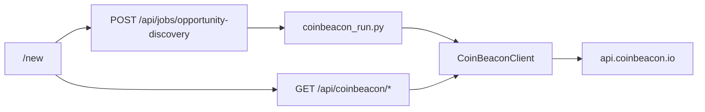

# Market opportunity discovery

Discovery on **`/new`** supports two data sources:

1. **CoinBeacon** — [CoinBeacon](https://coinbeacon.io/docs/api) screeners + trend board (Binance USDT perps by default). No strategy backtests; optional macro context and funding detail.
2. **Hyperliquid** — Lab scans the Hyperliquid perp universe (or a symbol list) using cached/exported OHLC. **Market scan** ranks bar metrics; optional **strategy screen** runs walk-forward backtests per strategy.

Set `scan_kind` in the job body: `coinbeacon_market`, `market_opportunity`, or `strategy_screen` (aliases `hyperliquid`, `hyperliquid_market`, `hyperliquid_strategy`).

## Setup

1. Create a free API key at [CoinBeacon developer](https://app.coinbeacon.io/developer).
2. On the Lab API host, set keys in `.env` (never commit; never expose to the browser):
   - `COINBEACON_API_KEY` — primary
   - `COINBEACON_API_KEY_ALT` — optional failover when credits are low or you hit rate limits
3. Restart `./run-lab-api.sh` or `./run-lab.sh`. `/health` should list `coinbeacon` in `features`.

## Architecture

## Job request body (CoinBeacon)

| Field | Default | Notes |
|-------|---------|--------|
| `scan_kind` | `coinbeacon_market` | When omitted, inferred from other fields (see Hyperliquid table) |
| `exchange` | `binance-futures` | Trend scanner venue |
| `trend_sort` | `1d` | `15m`, `1h`, `4h`, `1d`, `1w` |
| `trend_dir` | `desc` | Rank direction |
| `trend_quote` | `USDT` | Quote filter |
| `screener_presets` | all 15 presets | 5 credits each |
| `include_context` | `true` | globals + sentiment + structure (3×1 credit) |
| `detail_top_n` | `12` | Funding `/public/funding/coin/{base}` per top row (1 credit each) |
| `credit_reserve` | `50` | Abort if remaining daily credits fall below this |
| `out` | `results/discovery/<job_id>` | Artifact directory |

## Job request body (Hyperliquid)

| Field | Default | Notes |
|-------|---------|--------|
| `scan_kind` | inferred | `market_opportunity` / `hyperliquid` for bar-metrics scan; `strategy_screen` / `hyperliquid_strategy` for backtests |
| `symbols` | `[]` | Optional base list; empty = liquidity-ranked universe (`max_symbols`) |
| `resolutions` | `5,15,60,240,D` | One row per symbol × resolution (market scan) or × strategy (screen) |
| `months` | `6` | History window for OHLC load |
| `max_symbols` | `24` | Universe cap after volume filter |
| `min_mean_volume_quote` | `0` | Liquidity filter |
| `evaluate_strategies` | `true` when screening | Set `false` for market-only scan |
| `strategy_ids` | all HL-supported | Optional subset when screening |
| `use_cache` | `true` | Prefer `data/` CSV exports |

CoinBeacon API keys are **not** required for Hyperliquid runs.

## Artifact

`discovery_report.json` includes:

- `config.scan_kind`: `coinbeacon_market`
- `context`: macro blocks when enabled
- `screener.presets`: full preset responses
- `trend_scanner`: trend board payload
- `ranked`: merged opportunity rows (`composite_score`, `preset_hits`, trend scores, volume)
- `coin_details`: funding snapshots for top N bases
- `credits`: estimated cost and remaining balance from response headers

## Lab API

- `POST /api/jobs/opportunity-discovery` — CoinBeacon mode requires `COINBEACON_API_KEY`; Hyperliquid mode does not.
- `GET /api/catalog/discovery-runs` — list past runs (summary + config; no full report).
- `GET /api/catalog/discovery-runs/{id}` and `GET /api/catalog/discovery-runs/by-job/{job_id}` — full stored `report` JSON (UI loads this first; artifact file is fallback).
- `GET /api/coinbeacon/status` — key configured + usage.
- `GET /api/coinbeacon/public/{path}` — server-side proxy to CoinBeacon `/public/*`.
- Shortcuts: `/api/coinbeacon/screener/presets`, `/api/coinbeacon/screener`, `/api/coinbeacon/trend-scanner`.

## Credit budget

A full run with all 15 presets, macro context, trend board, and 12 funding lookups is roughly **~85 credits** (see plan in repo). Account limit: 2,000/day, 60/minute ([CoinBeacon docs](https://coinbeacon.io/docs/api#credits-and-limits)).

## Tests

- `tests/test_coinbeacon_client.py`
- `tests/test_coinbeacon_discovery.py`
- `tests/test_lab_api.py` (job route)

## Attribution

Show CoinBeacon, CoinMarketCap (screener), CoinGecko and alternative.me (macro) credits in UI where those blocks are displayed, per CoinBeacon data-source terms.
