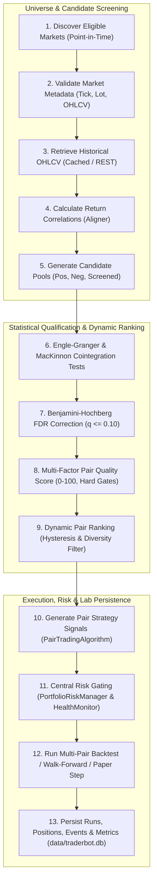

# Phase 7 Implementation Plan: Integrate Statistical Arbitrage into Traderbot and Research Lab

**Repository:** `Amahseyn/traderbot`  
**Author:** Senior Software Architect & Quantitative Trading Engineer  
**Date:** November 2026  
**Status:** In Review / Ready for Plan Approval  

---

## 1. Executive Summary & Architectural Integrity

Phase 7 brings together all previously developed Statistical Arbitrage components (Phases 1 through 6) into Traderbot's core engine, terminal, and Next.js Research Lab. 

### Core Architectural Directives
1. **Zero Duplication**:
   - **No Second Backtesting Engine**: Reuses `traderbot/backtesting/pair_engine.py` (`run_perp_pair_backtest`, `run_multi_pair_backtest`) and `traderbot/backtesting/walk_forward.py` (`run_pair_walk_forward`).
   - **No Second Database**: All state, runs, signals, positions, and risk decisions persist in the existing SQLite database (`data/traderbot.db`) via `lab/store/schema.py` and `lab/store/database.py`.
   - **No Second Risk System**: Reuses `traderbot/risk/manager.py` (inheriting from `RiskVerdict`), `traderbot/risk/portfolio.py` (`PortfolioRiskManager`), `traderbot/risk/pair_models.py` (`StatArbRiskVerdict`, `PairRiskState`), `traderbot/risk/execution.py` (`PairExecutionRiskManager`), and `traderbot/risk/cointegration_monitor.py` (`CointegrationHealthMonitor`).
   - **No Second Trade Lifecycle**: Extends Traderbot's terminal paper trading model (`traderbot/terminal/trader.py`, `traderbot/bots/base.py`) via `StatArbPaperTrader`.
2. **Strict Financial & Econometric Correctness**:
   - Zero lookahead bias: Decision at instant $T$ accesses only completed candle closes $\le T$.
   - Point-in-time universe selection: No forward-looking asset listings or survivorship bias.
   - Cost-aware edge gating: 0.19% roundtrip taker fee + slippage headroom enforced before any signal is evaluated.
   - Exact MacKinnon (2010) response surface polynomials for cointegration critical values.
   - Continuous Ornstein-Uhlenbeck AR(1) half-life bounds ($3 \le t_{1/2} \le 120$ bars).
3. **Research-First & Paper-First Default**:
   - Live execution is strictly gated behind explicit operator authorization, valid exchange keys, and existing `ExecutionPolicy`.

---

## 2. End-to-End Research Pipeline (13 Steps)

The unified pipeline connects discovery, statistical qualification, risk evaluation, and backtesting/paper simulation:

### Step Implementation Specification
1. **Discover Eligible Markets**: `traderbot/analysis/pairs/universe.py::discover_tradable_universe` filters inactive, delisted, or unlisted markets point-in-time.
2. **Validate Metadata**: Validates minimum lot size, tick size, notional constraints, and candle envelope sanity ($H \ge \max(O,C), L \le \min(O,C)$).
3. **Retrieve OHLCV**: Integrates `traderbot/data/bar_cache.py` and `traderbot/hyperliquid/market_data.py::fetch_hyperliquid_recent_closed_bars`. Avoids redundant network calls when cached bars are fresh.
4. **Calculate Correlations**: `traderbot/analysis/correlation/scanner.py` computes aligned return correlations across the tradable pool.
5. **Generate Candidate Pairs**: `traderbot/analysis/pairs/candidates.py` partitions pairs into strong positive ($r \ge 0.70$), strong negative ($r \le -0.70$), and screened weak candidates, capped by `max_candidates`.
6. **Run Cointegration Tests**: `traderbot/analysis/cointegration/scanner.py` computes OLS $\hat{\beta}$, ADF residuals with MacKinnon (2010) surfaces, Ornstein-Uhlenbeck continuous half-life, and Chow structural break tests.
7. **Apply FDR Correction**: `benjamini_hochberg_fdr` step-up procedure adjusts raw cointegration $p$-values across all scanned pairs.
8. **Calculate Pair Quality Score**: `PairQualityScorer` evaluates 8 normalized sub-scores ($0-100$). Any failed econometric gate triggers immediate hard rejection (`score = 0.0`).
9. **Rank Qualified Pairs**: `DynamicPairRanker` ranks pairs with a $+5.0$ hysteresis threshold against challengers and enforces spread correlation diversity ($|\text{Corr}(s_i, s_j)| \le 0.60$ and max 2 pairs per base token).
10. **Generate Strategy Signals**: `PairTradingAlgorithm.on_bar()` produces causal `PairSignal` (`enter_long_spread`, `enter_short_spread`, `exit`, `hold`).
11. **Apply Existing Risk Controls**: `PortfolioRiskManager.evaluate_pair_entry()` and `PairExecutionRiskManager.assess_execution_risk()` check capital concentration, gross/net notional, maintenance margin, and legging risk.
12. **Run Backtests or Paper Simulation**:
    - Backtest: `run_multi_pair_backtest` or `run_pair_walk_forward`.
    - Paper: `StatArbPaperTrader.step()` processes incoming bars.
13. **Persist Research Results**: Records run metadata, candidates, scores, positions, execution events, and metrics to `data/traderbot.db`.

---

## 3. Configurable Multi-Interval Scheduling

To prevent unnecessary historical data downloads and expensive repeated matrix calculations, tasks run on decoupled, independent schedule intervals:

| Scheduled Task | Default Interval | Invalidation / Recomputation Trigger |
|---|---|---|
| **Market Universe Refresh** | 86,400s (24h) | Expired TTL or exchange market definition update |
| **OHLCV Bar Ingestion** | 300s (5m) or Bar Close | New completed candle timestamp $\ge \text{last\_bar\_time} + \text{bar\_sec}$ |
| **Correlation Matrix Scan** | 3,600s (1h) | Accumulated $\ge 12$ new closed bars |
| **Cointegration Regression Scan** | 7,200s (2h) | Significant price divergence or new correlation candidates |
| **Pair Quality Ranking** | 3,600s (1h) | Cointegration scan completion or hysteresis review |
| **Strategy Signal Evaluation** | 60s (1m) or Bar Close | Strictly bar-aligned upon receiving latest closed candle |
| **Risk & Health Monitoring** | 15s | Every tick / mark-price update |

### Scheduling Implementation
- Module: `traderbot/analysis/pairs/scheduler.py` (`StatArbScheduler`, `StatArbScheduleConfig`).
- Integration: Plugs into `lab/jobs.py` as an asynchronous background worker (`job_type = "stat-arb-pipeline"` or `"stat-arb-paper"`), maintaining clean stop signals (`should_stop`) and heartbeats.

---

## 4. Paper Trading Engine

Paper execution mirrors the exact microstructure assumptions validated in backtests:

### Engine Contract (`traderbot/terminal/stat_arb_paper.py`)
- **Two-Leg Order Coordination**: Executes Dominant and Hedge legs sequentially or concurrently based on venue liquidity.
- **Microstructure Costs**: Deducts exchange-accurate taker fees (e.g. 0.045% Hyperliquid) and bid-ask spread crossing / square-root market impact via `traderbot/backtesting/fills.py`.
- **Partial Fills**: Tracks `filled_qty` vs `target_qty` per leg; detects unhedged delta.
- **Failed Leg & Legging Policy**:
  - `retry_hedge`: Re-attempts the unfilled hedge leg with slippage tolerance up to `max_slippage_pct`.
  - `immediate_flatten`: If hedge leg fails or times out, immediately unwinds the filled dominant leg at market to avoid unhedged naked directional risk.
- **Perpetual Funding Rate Settlement**: Discrete hourly funding debit/credit using `traderbot/risk/funding.py::calculate_funding_payment`.
- **Mark-to-Market Accounting**: Continuously maintains:
  - `gross_notional` and `net_notional`
  - `marked_equity` (mid-price marked)
  - `liquidated_equity` (cash after taker exit costs and slippage)
  - `unrealized_pnl` and `realized_pnl`
- **Emergency Exits**: Automatically force-flattens positions if:
  1. `PortfolioRiskManager.halted` is triggered (drawdown or daily loss breach).
  2. `CointegrationHealthMonitor.is_broken` reports structural breakdown or unit root failure.
  3. Spread diverges beyond critical stop threshold ($|z| > 4.0$).
  4. Holding period exceeds `max_holding_duration_bars` without mean-reversion.

---

## 5. Unified SQLite Persistence (`SCHEMA_VERSION = 11`)

All data persists in `data/traderbot.db` without introducing secondary storage:

### New / Enhanced Tables in `lab/store/schema.py`:
1. `pair_strategy_signals`:
   - `id`, `run_id`, `timestamp_utc`, `pair_id`, `action`, `spread`, `z_score`, `dominant_price`, `hedge_price`, `hedge_ratio`, `dominant_qty`, `hedge_qty`
2. `pair_paper_positions`:
   - `id`, `pair_id`, `status` (`OPEN`, `CLOSED`, `EMERGENCY_EXIT`), `opened_at_utc`, `closed_at_utc`, `entry_spread`, `exit_spread`, `leg_a_qty`, `leg_b_qty`, `entry_price_a`, `entry_price_b`, `exit_price_a`, `exit_price_b`, `realized_pnl`, `unrealized_pnl`, `total_fees`, `total_funding`, `snapshot_json`
3. `pair_execution_events`:
   - `id`, `position_id`, `pair_id`, `timestamp_utc`, `leg`, `action`, `requested_qty`, `filled_qty`, `fill_price`, `fee`, `slippage`, `execution_status`, `notes`
4. `pair_risk_decisions`:
   - `id`, `pair_id`, `timestamp_utc`, `check_type`, `verdict` (`APPROVED`, `REJECTED`, `HALTED`), `reason`, `metrics_json`
5. Seamless Run Catalog Integration:
   - Discovered backtests and walk-forward evaluations register as standard `evaluation_runs` (`run_kind = "pair_backtest"`, `"pair_walk_forward"`), making them immediately accessible in Lab's `/runs` catalog.

---

## 6. Lab Integration (Backend API & Next.js Frontend)

### 6.1 FastAPI Routes (`lab/pair_routes.py` & `lab/strategy_routes.py`)
- `POST /api/pairs/discovery`: Trigger full 13-step research discovery run (background job or synchronous).
- `GET /api/pairs/markets`: Eligible vs rejected markets with rejection reasons.
- `GET /api/pairs/correlation`: Correlation matrix, negative correlation rankings, rolling correlations.
- `GET /api/pairs/cointegration`: Qualified pairs, ADF statistics, $p$-values, hedge ratios, half-lives, Chow test breaks.
- `GET /api/pairs/rankings`: Dynamically ranked pairs with 0-100 score, liquidity, stability, hysteresis transitions.
- `GET /api/pairs/history`: Historical rank and score trajectories for any candidate pair.
- `POST /api/strategies/pair-walk-forward`: Chronological walk-forward validation on candidate pairs.
- `POST /api/strategies/multi-pair-backtest`: Multi-pair portfolio backtesting with shared capital.
- `GET /api/pairs/paper/positions`: Real-time open and closed pair positions, leg notional, and PnL.
- `POST /api/pairs/paper/emergency-exit`: Audited emergency flatten for a specific pair or entire portfolio.

### 6.2 Lab UI Views (`apps/lab-ui`)
Extends `/strategies` with a multi-tab Statistical Arbitrage suite styled strictly in accordance with `design-system/traderbot-lab/MASTER.md` (no raw hex colors, tokens only, `tabular-nums` on numbers, green/red strictly for PnL):

1. **Discovery & Markets Tab**: Tradable universe cards, candidate pool breakdown (positive/negative/weak), rejection reason tags.
2. **Correlation & Cointegration Tab**: High-contrast correlation heatmap, negative correlation leaderboards, ADF and Engle-Granger statistics table with finite-sample MacKinnon $p$-values.
3. **Rankings & Quality Tab**: Top 5/10/20 dynamic leaderboard, Pair Quality Score breakdown (liquidity, stability, stationarity), hysteresis transition badges (`NEW`, `PROMOTED`, `DEMOTED`, `EXIT`).
4. **Backtest & Walk-Forward Tab**: Multi-series SVG charts (Equity curve, Spread curve, $Z$-Score curve), trade ledger, out-of-sample fold performance with purge/embargo boundaries.
5. **Paper Trading & Risk Tab**: Live paper trading dashboard showing both leg positions, current spread and $Z$-Score, unrealized/realized PnL, cumulative funding, portfolio margin gauge, and an audited Emergency Flatten action.

---

## 7. Implementation Roadmap & Granular Tasks

### Task 1: Complete SQLite Persistence Schema & Repository Functions
- **Files**: `lab/store/schema.py`, `traderbot/analysis/pairs/persistence.py`
- **Failing Test**: `tests/test_pair_persistence_schema.py::test_persist_signals_positions_and_risk_decisions()`
- **Changes**:
  - Bump `SCHEMA_VERSION = 11`.
  - Add tables: `pair_strategy_signals`, `pair_paper_positions`, `pair_execution_events`, `pair_risk_decisions`.
  - Implement CRUD helpers: `record_strategy_signals()`, `record_paper_position()`, `update_paper_position()`, `record_execution_event()`, `record_risk_decision()`, `fetch_active_paper_positions()`.
- **Verification**: `pytest tests/test_pair_persistence_schema.py -q` passes.

### Task 2: Multi-Interval Scheduler & Caching Architecture
- **Files**: `traderbot/analysis/pairs/scheduler.py`, `lab/tasks.py`
- **Failing Test**: `tests/test_stat_arb_scheduler.py::test_independent_schedule_intervals_and_caching()`
- **Changes**:
  - Implement `StatArbScheduleConfig` and `StatArbScheduler`.
  - Wire task intervals (universe, ohlcv, correlation, cointegration, ranking, strategy, risk).
  - Add cache checks: avoid re-downloading fresh bars and avoid re-evaluating regressions when price window has not shifted.
- **Verification**: `pytest tests/test_stat_arb_scheduler.py -q` passes.

### Task 3: Two-Leg Paper Trading Engine & Reconciliation
- **Files**: `traderbot/terminal/stat_arb_paper.py`, `traderbot/terminal/session.py`
- **Failing Test**: `tests/test_stat_arb_paper_trading.py::test_two_leg_paper_lifecycle_fees_funding_and_emergency_exit()`
- **Changes**:
  - Implement `StatArbPaperTrader` with two-leg execution, partial fills, failed leg unwinds, funding deduction, and mark-to-market reconciliation.
  - Wire emergency flatten with operator audit log.
- **Verification**: `pytest tests/test_stat_arb_paper_trading.py -q` passes.

### Task 4: Complete End-to-End 13-Step Research Pipeline Runner
- **Files**: `traderbot/analysis/pairs/pipeline.py`, `lab/tasks.py`
- **Failing Test**: `tests/test_stat_arb_research_pipeline.py::test_full_13_step_research_pipeline_end_to_end()`
- **Changes**:
  - Unify Steps 1–13 into `run_stat_arb_research_pipeline()`.
  - Register results with `lab/store/record.py::record_evaluation_run` for Run Catalog visibility.
- **Verification**: `pytest tests/test_stat_arb_research_pipeline.py -q` passes.

### Task 5: Lab API Endpoints & Auth Verification
- **Files**: `lab/pair_routes.py`, `lab/strategy_routes.py`, `lab/app.py`
- **Failing Test**: `tests/test_pair_research_api_endpoints.py::test_all_research_and_paper_endpoints()`
- **Changes**:
  - Expose `/api/pairs/markets`, `/api/pairs/correlation`, `/api/pairs/cointegration`, `/api/pairs/paper/positions`, `/api/pairs/paper/emergency-exit`, `/api/strategies/pair-walk-forward`, `/api/strategies/multi-pair-backtest`.
  - Ensure all POST mutations enforce `verify_lab_api_token`.
- **Verification**: `pytest tests/test_pair_research_api_endpoints.py -q` passes.

### Task 6: Lab UI Components & Research Dashboard
- **Files**:
  - `apps/lab-ui/src/lib/api.ts` (API client types and methods)
  - `apps/lab-ui/src/components/StatArbDiscoveryView.tsx`
  - `apps/lab-ui/src/components/StatArbCorrelationView.tsx`
  - `apps/lab-ui/src/components/StatArbCointegrationView.tsx`
  - `apps/lab-ui/src/components/StatArbRankingsView.tsx`
  - `apps/lab-ui/src/components/StatArbPaperTradingView.tsx`
  - `apps/lab-ui/src/app/strategies/page.tsx`
- **Verification**:
  - `npm --prefix apps/lab-ui run test` passes.
  - `npm --prefix apps/lab-ui run verify:ui` passes with 0 anti-pattern violations.

### Task 7: Reliability, Fault Injection & Full Regression Validation
- **Files**: `tests/test_stat_arb_reliability.py`
- **Coverage**:
  - Process restart recovery with open positions.
  - Idempotent duplicate job execution.
  - Stale bar fail-closed behavior.
  - Partial fill legging unwinds.
  - Full suite run: `.venv/bin/pytest tests/ -q`.
- **Verification**: All unit, integration, and regression suites pass cleanly.

---

## 8. Safety & Live Trading Governance

1. **Default Mode**: Always `paper`.
2. **Explicit Operator Promotion**: Live orders require `--live`, valid credentials, operator audit attribution, and a clean run of `audit_backtest_causality()`.
3. **Emergency Circuit Breakers**: Latching halts in `PortfolioRiskManager` require operator unhalt with recorded justification. No bypass is permitted.

